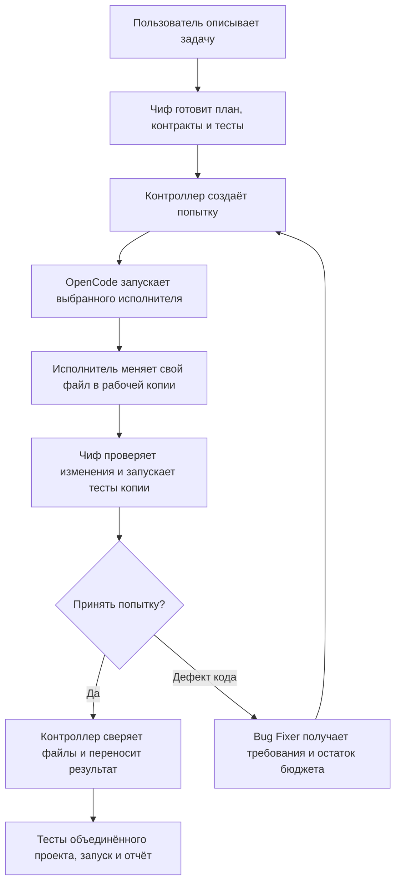
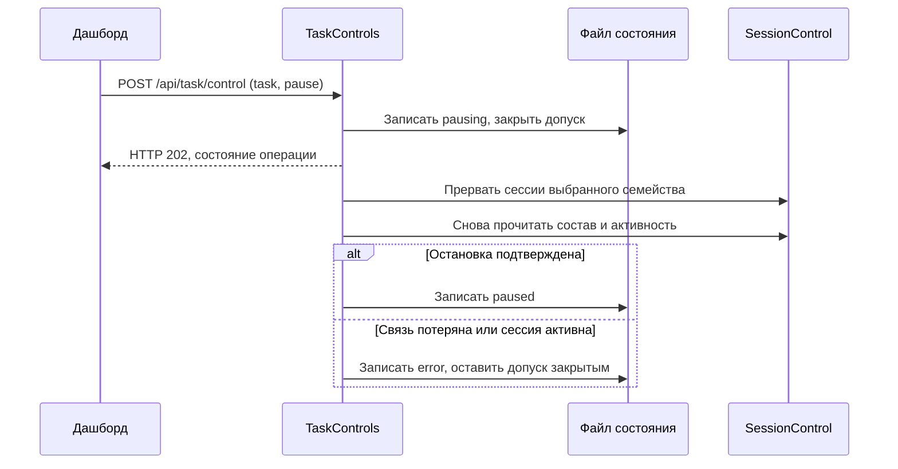
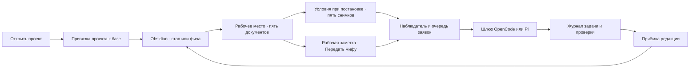
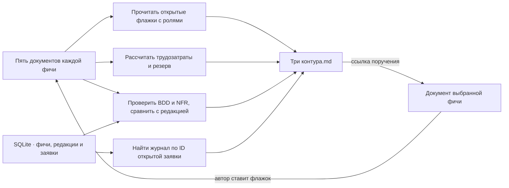
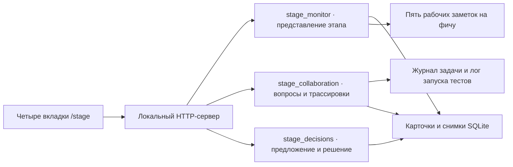
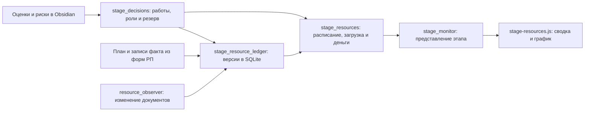
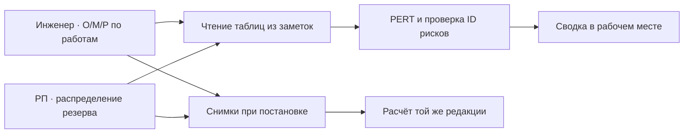
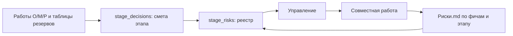
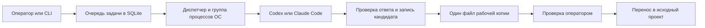

# Как устроен Чиф. Путеводитель для Java-разработчика

Исходники и выпуски находятся в [chief-orchestrator](https://github.com/polar-byter/chief-orchestrator).
Для повторения установки возьмите ZIP и контрольную сумму со [страницы v1.0.0](https://github.com/polar-byter/chief-orchestrator/releases/tag/v1.0.0).

Начните с вопроса «Как изменение из рабочей копии исполнителя попадает в мой
проект?». Ответ проведёт через архитектуру, Python-код, тесты и файлы на диске.
Затем разберите паузу. Она показывает другую сторону системы — как команда из
браузера влияет на выполняющуюся работу. Оба разбора относятся к OpenCode-киту
на основе `329bda1`. Для проектной базы начните с разбора «Как отметка в
Obsidian становится работой Чифа». За ним идёт путь поручения из документа
фичи в обзор ролей. Состояние реализации по средам и экранам приведено в
[спецификации](UNIVERSAL_KIT_SPEC.ru.md).

## 1. Функциональная схема



На схеме показан путь через изолированные попытки. Он требует общей службы
OpenCode и привязки к корневой сессии проекта. В последовательном режиме Чиф
вызывает `delegate`, передаёт поручение исполнителю и проверяет изменения в
основной копии. Переноса файла из изолированной копии в этом режиме нет.
Ошибки API, квоты и настройки имеют собственный путь восстановления. [Режимы исполнения](PARALLEL_EXECUTION.ru.md) · [Восстановление](EXECUTION_RECOVERY.ru.md).

## 2. Карта модулей и данных

| Вопрос при чтении | Куда смотреть | Где заканчивается ответственность |
| --- | --- | --- |
| Как кит попадает в прикладной проект? | [installer.py](../../kit/installer.py) и [описание установки](INSTALLER.ru.md) | `install_project` работает с каталогом назначения и файлами поставки. В установленном проекте `app/` и `tests/` относятся к самому приложению, `kit/` содержит инструмент разработки |
| Как выбранная модель и промпт становятся конфигурацией процесса? | [run_opencode.py](../../kit/run_opencode.py) и [руководство по моделям](../user/LOCAL_MODELS.ru.md) | `prepare` читает конфигурацию проекта и ролевые промпты, готовит настройки запуска OpenCode. Какие роли реально работали, устанавливают по сессиям и журналу |
| Кто выбирает файлы, тесты и критерии? | [Промпт Чифа](../../kit/prompts/master-chief.md) и [правила проекта](../../AGENTS.md) | Чиф задаёт содержание поручения. Допустимость записи принятого результата проверяет программа |
| Где живёт история задачи? | [TaskJournal](../../kit/journal.py) | Читает события, проверяет их формат и предоставляет блокировку записи. События одной задачи лежат в `.metrics/<task>/events.jsonl` |
| Кто связывает попытку, инспекцию, тест и решение Чифа? | [TaskMetrics](../../kit/task_metrics.py) | Методы `delegate`, `inspect`, `test`, `review` и `finish` проверяют условия операций. Строка события содержит ссылки на исходные снимки и результаты |
| Как определяется изменение файла? | [delegation_guard.py](../../kit/delegation_guard.py) | `take_project_snapshot` строит отображение относительного пути в хеш. `compare_project_snapshots` отличает изменения выданных файлов от посторонних |
| Кто отвечает за одну изолированную попытку? | [ExecutionController](../../kit/execution_controller.py) | `launch` готовит рабочую копию и сессию, `watch` наблюдает, `stop` фиксирует исход остановки, `integrate` переносит один принятый файл |
| Кто решает, можно ли продолжать? | [execution_policy.py](../../kit/execution_policy.py) и [loop_guards.py](../../kit/loop_guards.py) | Первый модуль определяет лимиты попытки и выбор следующего действия по роли и причине. Второй оценивает историю запусков и пределы всей задачи |
| Кто разговаривает с OpenCode? | [SessionControl](../../kit/dashboard/session_control.py) | `call` вызывает установленный CLI с каталогом проекта, параметрами и тайм-аутом. Ошибки переводятся в форму, пригодную для отображения |
| Кто управляет паузой? | [TaskControls](../../kit/dashboard/controls.py) и [task_control_state.py](../../kit/task_control_state.py) | Первый координирует операцию над семейством сессий. Второй сохраняет переход в `.metrics/.task-controls/<task>.json` и проверяет допуск к работе |
| Кто разбирает тесты и готовит итоги? | [suite_runner.py](../../kit/suite_runner.py), [usage_report.py](../../kit/usage_report.py), [task_report.py](../../kit/task_report.py) | Запуск тестовой команды и чтение JUnit XML отделены от подсчёта расхода и чтения сохранённого отчёта |

Если вы привыкли к Java, начните с методов экземпляров. Параметр `self` —
объект, который в Java доступен как `this`. В объявлении
`TaskMetrics(TaskJournal, SuiteRunnerMixin, UsageReportMixin)` Python собирает
методы нескольких базовых классов. Поэтому реализацию `self.read(task)` ищите
в `TaskJournal`, а разбор XML — в модуле запуска тестов. Конструкция
`with self.metrics.lock(self.task)` ограничивает время удержания блокировки
аналогично `try-with-resources`. Контроллер принимает `service` в конструкторе.
Тест передаёт туда объект с нужными методами, как передал бы реализацию
интерфейса в Java. Контейнер зависимостей здесь не требуется.

## 3. Одна попытка от поручения до интеграции

Откройте [test_parallel_execution.py](../../kit/tests/test_parallel_execution.py).
В `ParallelExecutionTests.setUp` создаются файлы `a.py`, `b.py`, `c.py`,
один общий контракт и небольшие тесты. В тесте
`test_two_isolated_workers_are_checked_and_integrated_independently` задача
`demo` выдаёт поручения `a` и `b`, занимая два места. Третье поручение
ждёт. Вместо живой модели работает `FakeService`, поэтому пример удобно
повторить и разобрать по состоянию файлов.

1. **Допуск.** В `ExecutionController.launch` проверьте порядок проверок.
   Контроллер сверяет каталог корневой сессии, лимиты и зависимости. Зависимость
   готова, когда одна и та же её попытка принята и интегрирована. Далее он
   копирует исходники в рабочий каталог и вызывает `TaskMetrics.delegate`.
   Эта операция фиксирует требования, разрешённый файл и исходный снимок.
2. **Привязка.** Событие `delegation` получает `event_id` — идентификатор попытки.
   Поле `worker_id` обозначает исполнителя этой копии. В `attempt_session`
   записываются ссылка `delegation_id` и ID сессии провайдера. По первой ищут
   проверки попытки, по второй обращаются к OpenCode. Перед отправкой задания
   контроллер проверяет права сессии и готовность наблюдения.
3. **Остановка и инспекция.** Вспомогательный метод теста `accept` меняет тело
   функции в выданной копии и завершает попытку. `TaskMetrics.inspect` требует
   запись `attempt_end` с подтверждённой остановкой. По снимкам определяет,
   что успел изменить исполнитель, и сохраняет событие `inspection`.
4. **Приёмка.** `TaskMetrics.test` с ID попытки запускает команду в её копии.
   Чиф сопоставляет каждое исходное требование с символом кода и конкретным
   тестом. `review` проверяет границы изменений, полноту этих ссылок, результат
   запуска и снимок файлов. Решение `accepted` записывается для этой попытки.
5. **Интеграция.** `ExecutionController.integrate` под блокировкой задачи
   сверяет хеши основного файла и общих контрактов с базой попытки. Проверяет
   и копию после теста. Только затем заменяет назначенный файл через временный
   файл и пишет событие `integration`. После интеграции `a` тест проверяет,
   что основной `b.py` всё ещё содержит прежнее тело.
6. **Завершение задачи.** В конце изолированного цикла `TaskMetrics.finish`
   проверяет последние попытки, интеграцию и полный прогон объединённого проекта.
   В отчёт попадают исходы и доступные данные расхода. Подтверждение запуска
   приложения и обзор интерфейса имеют собственные свидетельства. [Порядок завершения](BROWSER_AND_REPORT.ru.md).

### Два отказа, которые стоит проследить в отладчике

В `test_shared_contract_change_blocks_integration` другой участник меняет
`CONTRACT.md` после принятия попытки. Условие в `integrate` проверяет
`now.get(p) != digest` для сохранённых `base_hashes`. При несовпадении метод
завершается **до замены файла**. Основная версия `a.py` остаётся прежней.
Инженеру предстоит подготовить и проверить попытку по актуальному контракту.

В `test_failed_integration_journal_write_restores_main_source` тест имитирует
ошибку записи события после замены файла. Обработчик исключения возвращает
сохранённые байты. Следующий вызов интеграции может пройти успешно. Это
проверка обработки исключения внутри процесса. Устойчивость к выключению
питания между двумя операциями потребовала бы отдельного эксперимента.

Чтобы повторить первый сквозной тест на Windows, из корня кита с уже начатой
задачей подставьте её ID вместо `TASK_ID`. Команда запускает временный тестовый
проект, результат записывается в журнал выбранной задачи.

```powershell
.\kit\python.cmd kit/task_metrics.py test --task TASK_ID --scope parallel-example -- .\kit\python.cmd -B -m unittest kit.tests.test_parallel_execution.ParallelExecutionTests.test_two_isolated_workers_are_checked_and_integrated_independently
```

В прикладном проекте на Java Чиф сопоставляет требование с тестом JUnit.
Например, в проекте Maven с Surefire параметр `--junit-dir target/surefire-reports`
указывает киту, где читать XML после запуска `mvn test`. Посмотрите
`fresh_xml_files` и `parse_junit_files`: первый отбирает отчёты по времени,
второй считает элементы `testcase` и их исходы. Для изолированного поручения
нужны также `--attempt` и его `--scope`. Для полной проверки после интеграции
используют `--scope full` и тесты всего проекта.

## 4. От кнопки «Приостановить» до подтверждения



Найдите ветку `/api/task/control` в [runtime.py](../../kit/dashboard/runtime.py).
HTTP-обработчик проверяет запрос и вызывает `TaskControls.request`. Метод
записывает промежуточное состояние под блокировкой и запускает фоновую работу.
Ответ 202 сообщает о принятии команды. По завершении браузер считывает новый
статус. Смотреть только на успешный HTTP-ответ для диагностики недостаточно.

Теперь откройте `TaskControls.stopped_tree`. Между первым чтением дерева и
прерыванием у Чифа мог появиться дочерний исполнитель. Поэтому код повторно
читает состав и активность семейства и требует стабильного состава в соседних
проходах. Для обычной паузы очередь сохраняется. При отмене и паузе из-за
лимита провайдера вызывается очистка. Проверьте ветку `clear_queue` в `_run`
и соответствующие тесты в [test_controls.py](../../kit/dashboard/tests/test_controls.py)
и [test_quota_reconfiguration.py](../../kit/tests/test_quota_reconfiguration.py).

## 5. Как расширять систему

### Рабочие шлюзы OpenCode и Pi

Начните с [runtime_selection.py](../../kit/runtime_selection.py). Старый проект
без `pi-kit.json` получает `SessionControl`. Значение `"runtime": "pi"`
выбирает [PiSessionControl](../../kit/runtimes/pi_gateway.py). Шлюз находит
службу своего проекта, сверяет владельца процесса и передаёт операцию
[брокеру](../../kit/runtimes/pi_broker.py). Брокер связывает ID сессии с
процессом Pi и его историей. Изолированный исполнитель получает ограничения
доступа через [расширение Pi](../../kit/pi/worker_permissions.ts). Методы
`inspect`, `review` и `integrate` применяются в обеих средах. Проверку
переоткрытия журнала с изменённым выбором среды можно проследить в
[test_runtime_selection.py](../../kit/tests/test_runtime_selection.py).

Общий [скилл Чифа](../../kit/skills/chief-orchestrator/SKILL.md) указывает
на контракты проекта. Код его [установки](../../kit/install_chief_skill.py)
выбирает каталог обнаружения агента и сохраняет ручную правку, если файлы расходятся.

### Разбор отказа при одновременном старте двух задач

Оба процесса начинают с `TaskMetrics.start` и запрашивают `TaskJournal.task_dir`
до создания своей папки. На Windows у ещё отсутствующего каталога результат
`Path.resolve()` иногда имел префикс длинного пути `\\?\`. При создании общей
`.metrics` другим процессом исходный и разрешённый пути могли обозначать один
и тот же каталог и различаться при сравнении. В десяти неуспешных повторах из
36 оба признака перенаправления были ложными. Второй процесс выходил ещё до
запуска HTTP-сервера. Сейчас журнал проверяет `is_symlink()` и `is_junction()`
у `.metrics` и папки задачи под разрешённым корнем проекта. После исправления
все 36 повторов с двумя CLI завершились успешно. [Проверки путей журнала](../../kit/tests/test_task_journal.py) · [Сценарий с двумя процессами](../../kit/dashboard/tests/test_launcher.py).

### Что менять при новом требовании

**Поле открылось за краем окна.** В [конфигураторе](../../kit/configurator/desktop.py)
кнопка дополнительных параметров показывает поле и запоминает запрос прокрутки.
Tk сначала создаёт элементы окна, затем рассчитывает их положение. Если очередь
событий занята, даже через 30 мс высота области может составлять один пиксель.
Поэтому расчёт привязан к событиям появления поля и изменения размера области.
[Проверка компактного окна](../../kit/configurator/tests/test_desktop.py) сверяет
координаты обеих границ поля и нижней панели после раскрытия.

### Как отметка в Obsidian становится работой Чифа



Начните с обработчика команды `execute` в [project_docs.py](../../kit/project_docs.py).
Для Java-разработчика это роль прикладного сервиса. Он передаёт работу владельцам
состояния. При `init` первым вызывается [ProjectVault.connect](../../kit/project_vault.py).
UUID в `.chief-project.json` можно хранить в Git. Путь на конкретной машине
находится в `.metrics/project-vault.json`. При переносе путь меняется, UUID
остаётся тем же. В самой базе SQLite хранит каталог записей, редакции и состояние
доставки. Пользователь читает и редактирует обычные заметки Markdown.

**От карточки к файлу.** Рассмотрим фичу `feature-workspace` самого Чифа.
`ProjectVault.add` регистрирует ID и этап. [ensure_workspace](../../kit/project_workspace.py)
подготавливает обзор и пять документов в `Документы/feature-workspace/`. Условный
аналог на Java — прикладной сервис, вызывающий хранилище и генератор представления.
Здесь достаточно функций: каталог `SECTIONS` задаёт ключи и подписи для навигации
и CLI, а [Markdown-шаблоны](../../kit/templates/project-workspace) задают поля документов.
В заметке NFR ссылка «Карточка» содержит полный путь внутри базы, поэтому совпадение
названий двух фич не переводит пользователя в другой этап.

**Кому принадлежит запись.** Оператор редактирует пять файлов в Obsidian.
Открытие не записывает их повторно. До завершения подготовки допустим повтор:
`publish_new` создаёт только отсутствующие файлы. Маркер готовности хранится в
`.chief/workspaces/<ID>.json`; после него отсутствие файла требует восстановления.
У старой карточки Чиф дописывает только навигацию. Черновик `Рабочее место/<название> (<ID>).md`
с флажком и заголовком «Что изменить» остаётся прежним. Обзор `Документы/<ID>/Рабочее место.md`
отправляет именно в этот черновик.

**Почему нужен снимок.** Аналитик передал заявку с порогом NFR и позже уточнил
этот порог. `document_snapshot` сохраняет путь, исходный текст и SHA-256 каждого
документа при постановке. Исполнитель получает этот материал с заявкой.
`compare_revision` показывает изменённые строки; `accept_revision` отказывает в
приёмке по устаревшим условиям. Повторная подача сохраняет предыдущую заявку
и выдаёт новый ID. Архив показывает буквальный Markdown принятого снимка:
последующая правка исходного файла не меняет свидетельство. Старые редакции
без поля `documents` читаются в исходном формате. Навигация, дописанная при
обновлении старой карточки, сама по себе не считается изменением её требований.

Начните проверку с [test_project_workspace.py](../../kit/tests/test_project_workspace.py):
там есть две одноимённые фичи, повтор после прерывания и изменение порога между
подачей и приёмкой. Реальные проекты хранятся за пределами тестовых каталогов.

За установку, локальный профиль и проверку активной вкладки отвечает
[obsidian_app.py](../../kit/obsidian_app.py). После открытия запускается один
[наблюдатель проекта](../../kit/project_inbox.py). Представьте, что оператор
меняет критерий фичи и ставит флажок. Наблюдатель фиксирует переход, передаёт
снимок файла в [request_revision](../../kit/project_revisions.py) и получает
ID заявки и номер базовой редакции. Один ID связывает черновик, журнал задачи
и сообщение в корневую сессию. [Передача Чифу](../../kit/project_dispatch.py)
сверяет каталог проекта и роль сессии до вызова модели. После ответа с нужным
ID сообщения наблюдатель публикует квитанцию.

Если изменился черновик, `compare` выводит разницу, а приёмка предыдущего снимка
останавливается. При успешной приёмке новая заметка содержит результат и ссылку
на предыдущую редакцию. У этапа сохраняются состав фич и их редакции на обе даты.
Ручные заметки, прежние проверки и история решений доступны после повторного
открытия базы. [Проверки редакций](../../kit/tests/test_project_revisions.py) ·
[Проверки передачи и повторов](../../kit/tests/test_project_dispatch.py) ·
[Инструкция для запуска](../user/PROJECT_DOCUMENTATION.ru.md).

### Как поручение попадает в «Три контура»



**Кому принадлежит состояние.** Поручение живёт в той заметке, где его записал
автор. Например, строка `- [ ] #рп Согласовать резерв R2` в разделе «Риски»
попадает к РП. Две метки на одной строке показывают поручение в обоих контурах.
Когда один из участников ставит флажок, поручение исчезает из обоих списков.
Верхний счётчик каждой роли учитывает только открытые поручения. Ниже Чиф
отдельно показывает расчёты, состояние проверок или заявки. Для Java-разработчика
`RoleTask` близок к `record` с полями роли и текста. Функцию `open_tasks`
можно проверить на одной строке без файловой системы и Obsidian.
[Правила разбора флажков](../../kit/role_tasks.py).

**Как собрать строку и открыть нужный источник.** `refresh_overview` выбирает
фичи привязанного проекта. Внутри блокировки `overview_revisions` читает из
SQLite последнюю редакцию и открытую заявку для каждой фичи. Рабочие тексты
берутся из каталога `Документы/<ID>`. Например, для поручения РП в фиче
`effort-risk` рабочая ссылка ведёт в `Документы/effort-risk/Риски.md`, а ссылка
«ред. 1» в той же строке открывает сохранённую историю. Название фичи можно
повторить в другом этапе. Выбор документа зависит от ID, поэтому совпадение
названий не меняет адрес. РП получает сумму из той же функции, что и «Рабочее
место». Аналитик видит явный пробел в таблице BDD/NFR или изменение документа
относительно снимка. Инженер видит состояние исполнения по журналу связанной
заявки и основание принятого решения в истории.
[Сборка обзора](../../kit/project_overview.py) · [чтение редакций](../../kit/project_revisions.py).

**Когда обновляется заметка.** Наблюдатель проверяет изменения исходных файлов,
базы и журналов связанных задач. Если признаки изменений прежние, он пропускает
чтение текстов и запись обзора. При пересборке контрольная сумма защищает
ручную правку вычисляемой заметки. Если недоступен один исходный документ,
обзор указывает фичу и раздел, а поручения соседних фич остаются видны.
[Наблюдатель](../../kit/project_inbox.py) · [публикация вычисляемых заметок](../../kit/vault_reports.py).

**Проверка на самом Чифе, 14.11.2026.** Из «Трёх контуров» в Obsidian РП
открыл риски `effort-risk`, аналитик — BDD `role-overview`, инженер — NFR
той же фичи. После отметки проверочного флажка в NFR счётчик инженерной
команды изменился с двух на один. У РП и аналитика осталось по одному
поручению. Для отладки навигации начните с теста
`test_same_titles_resolve_to_correct_section_feature_stage_and_revision`.
Для проверки перехода заявки от журнала до принятого решения откройте
`test_only_feature_request_drives_engineering_state`. Оба находятся в
[тестах обзора](../../kit/tests/test_project_overview.py).

**Сколько занимает обновление.** На Windows 11 с Python 3.13.16 измерили путь
от сохранения нового поручения в NFR до появления его текста и счётчика в
заметке обзора. У штатного наблюдателя был отдельный проект со 100 фичами и
500 исходными документами. Пять сохранений в разных фичах дали 1,862–3,295 с,
медиана 2,797 с. Период опроса наблюдателя — 2 с. Эти значения относятся к
обновлению файла. Время отрисовки Obsidian и целевой порог измеряются отдельно.

### Как устроен командный монитор этапа



**От выбора этапа до пункта в списке.** Ссылка «Монитор этапа» ведёт на
`/stage`. Этап, фича, вкладка и выбранная версия документов хранятся в адресе
страницы. `stage_view` начинает с привязки репозитория к базе и выбирает
фичи по родительскому ключу. Из заметок он читает помеченные роли и флажки.
У совместного поручения один флажок. Счётчик команды включает это поручение,
а общая вкладка учитывает его один раз. Исторический текст открывается
из сохранённой редакции. Рабочий адрес открывает сегодняшний файл.
[Чтение этапа](../../kit/dashboard/stage_monitor.py) · [экран](../../kit/dashboard/static/stage.js).

**От вопроса до второго обсуждения.** Клиент посылает команду с UUID,
редакцией и адресатом. После ответа по вопросу можно открыть обсуждение
заново. Аналог optimistic locking для Java-разработчика — поле
`expected_version`: если коллега успел ответить, потребуется сверить историю.
SQLite сохраняет событие и ID операции в одной транзакции. Повтор той же
отправки возвращает сохранённое событие. Лента и статус собираются из
записанных действий. У формы решения отдельный контракт и свои пределы.
[Команды обсуждения](../../kit/stage_collaboration.py) · [проверки повторов](../../kit/tests/test_stage_collaboration.py).

**От инварианта до теста.** Для связи нужны фича или сам этап, раздел,
версия и точная цитата. Чиф проверяет источник и сохраняет текст и SHA-256.
У рабочего текста, исходного снимка и принятой редакции разные статусы.
Задача проверяется в журнале проекта, запуск выбирается по `event_id`.
Если задан отдельный Python-тест, его полное имя и единственный исход должны
присутствовать в подробном логе unittest. Краткий лог позволяет сослаться
на прогон целиком. По ссылке на лог сервер находит файл из записи этого
события. [HTTP-маршруты](../../kit/dashboard/runtime.py) ·
[проверка через HTTP](../../kit/dashboard/tests/test_stage_http.py).

**От прогноза до утверждённой суммы.** Для каждой фичи применяется существующий
расчёт O/M/P. Функция `decision_view` возвращает охват, известную часть и последнюю
принятую оценку. Команда `decide` повторно читает входы, проверяет основу,
открытые блокирующие вопросы и версию полномочий, затем записывает решение.
Допуск задаётся относительно утверждённой суммы при выдаче полномочий.
Так несколько небольших автоматических поправок сохраняют исходную границу.
В принятом предложении остаются тексты оценок и рисков, отпечатки входов и источник правила.
[Расчёты и решения](../../kit/stage_decisions.py) · [граничные тесты](../../kit/tests/test_stage_decisions.py).

**Пример проекта Чифа.** Этап `project-docs` содержит шесть фич. Известная
оценка `effort-risk` составляет 15,3 чел·ч. Вопрос о резерве прошёл путь
«вопрос → ответ → повторное обсуждение → ответ». Для FR-23 открыта цепочка
от текста правила до теста повторного обсуждения и его лога. В управленческом
контуре предложение по неполной оценке осталось открытым для РП.
Редакция 1 самого этапа содержит только карточку. Монитор читает перечень
документов из сохранённой редакции. В схеме ссылка «Базовая редакция»
открывает карточку, а ссылка в узле инварианта ведёт к разделу с правилом.

### От O/M/P до графика «Управление»



**Как проследить одну цифру.** Возьмите работу с O/M/P 8/12/24.
В `resource_forecast` она получает постоянный адрес `effort-risk/W1`,
роль «Инженер» и труд `40/3`. Вторая строка `effort-risk/@R2` содержит
2 чел·ч резерва. Связанные надбавки нескольких фич сводятся к одному
источнику до распределения по командам. Общеэтапные работы можно внести
в таблицу самого этапа. За передачу этих данных в ресурсный прогноз
отвечает [stage_decisions.py](../../kit/stage_decisions.py).

**Граница вычисления.** Для Java-разработчика `calculate_resources` удобно
читать как метод сервиса, которому переданы четыре значения: оценка, план,
факты и дата сверки. Он не открывает файлы. Сначала строит доступную ёмкость
по ролям, затем размещает работы после их предшественников в свободное время
команд. При равной доступности порядок разрешается стабильным ID. Начало
и конец работы сохраняются как точные доли рабочего дня. Календарь переводит
их в даты, ставки и тарифы — в деньги. `evaluate_plan_at` возвращает
накопленный план к концу указанного дня. Добавление другого способа
распределения работ начните с примеров очередности, параллельности и ожидания.
[Модель](../../kit/stage_resources.py) · [Примеры расчёта](../../kit/tests/test_stage_resources.py).

**Граница записи.** Форма на вкладке РП отправляет `POST /api/stage/resource`.
Журнал проверяет проект, версию и отпечаток основы внутри транзакции базы.
Повтор одной операции возвращает сохранённую квитанцию. В историю входят
исходные данные, дата учёта и время регистрации. Например, табель за вторник,
внесённый в четверг, уточняет накопленный факт со вторника. Квитанция старой
версии по-прежнему показывает известные при её записи данные. Ссылка
«Исходные данные» открывает `GET /api/stage/resource?stage=…&version=…`.
[Журнал](../../kit/stage_resource_ledger.py) · [Проверки повторов и истории](../../kit/tests/test_stage_resource_ledger.py).

**Граница наблюдения.** У дашборда один фоновый наблюдатель. Для этапов с
заведённым журналом он проверяет состав фич и признаки изменений двух входных
файлов каждой карточки. При изменении входов под блокировкой сверяется сама
оценка. Так перезапись файла с теми же данными и перезапуск процесса сохраняют
число точек на графике. Команды записи и чтение монитора используют одну
предметную модель. [Наблюдатель](../../kit/dashboard/resource_observer.py) ·
[HTTP](../../kit/dashboard/stage_monitor.py) · [Рабочее место РП](../../kit/dashboard/static/stage-resources.js).

**Проверка на Чифе.** В рабочем `project-docs` была оценена одна из шести
фич, известны 15,3 чел·ч. Для проверки полного цикла использована изолированная
копия этой базы. Там работам инженера и аналитика задали 8 и 4 чел·ч,
ставки 1 000 и 500 ₽/ч, ёмкость каждой команды 4 чел·ч в рабочий день.
После инженерной работы нужен один рабочий день ожидания. Для окна 9–13 ноября
2026 года получились 12 ноября и 10 105 ₽, включая 5 ₽ API и 100 ₽ прочих
расходов. На 10 ноября план предусматривал 8 чел·ч, табель содержал 7.
Изменение инженерной оценки до 12 чел·ч перенесло прогноз на 13 ноября,
увеличило его до 14 105 ₽ и загрузку инженеров до 60% от 20 чел·ч ёмкости.
Первоначальный план остался доступен. Расходы и часы этого примера внесены
только в контрольную базу.

### Другие примеры изменений

**Изменилось правило приёмки.** Начните с инварианта, входных событий
`TaskMetrics.review` и теста, который различает допустимую и чужую попытки.
Если нужен новый факт, определите автора записи и чтение старого журнала без
поля. Дашборд показывает решение с основанием из ядра. Иначе два экрана смогут
принять разные решения по одним файлам.

**Добавляется среда выполнения.** Проследите вызовы `self.service` в контроллере
и использование `SessionControl` в дашборде. Объясните, как среда идентифицирует
корень и дочерние процессы, подтверждает остановку и сообщает неизвестный расход.
Здесь нужен Adapter. Проверки бюджета и соответствия требованиям остаются у
своих владельцев. Для Pi существующая граница разобрана в [сравнении реализаций](AGENT_COMPATIBILITY.ru.md).

### Как из двух таблиц получается один итог



**Предметное правило.** Для Java-разработчика `WorkEstimate` и `RiskAllowance`
соответствуют записям с входами для расчёта. Функция `estimate_effort` получает
их списки. Для каждой работы она проверяет порядок O/M/P и единицу чел·ч.
Среднее и разброс хранятся как точные дроби до показа с одним десятичным знаком.
Ключ добавки — ID события. Одна запись реестра может ссылаться на несколько работ,
поэтому сумма резерва проходит по рискам ровно один раз. Если R1 уже указан в
O/M/P работы W1, отдельная надбавка по R1 даёт конфликт с именами обеих записей.
Часы выделяет РП. Возможную вероятность события он обосновывает в реестре.
[Исходник расчёта](../../kit/effort_estimate.py).

**Вход и представление.** Адаптер разбирает таблицы обычного Markdown в документах
оценки и рисков. Он читает прежнюю таблицу работ с семью колонками и текущую с
восьмой колонкой «Риски в O/M/P». Если данных не хватает, сводка показывает
охват и известную часть. При неверном M выводит поле и ID работы.
[Разбор таблиц и вывод](../../kit/estimate_documents.py).

**Чтение в Obsidian.** При открытии рабочее место подключает входы и публикует
`Документы/<ID>/Расчёт трудозатрат.md`. Наблюдатель обновляет файл при изменении
любой из двух заметок, Obsidian показывает его раздел «Сводка» в рабочих документах.
Один процесс ведёт изменения оценок и приём заявок. Контрольная сумма позволяет
обнаружить ручную правку производного файла. Исходные таблицы принадлежат
авторам. В архив заявки попадает результат, полученный из двух сохранённых
текстов при постановке. Открытие старого архива воспроизводит ту редакцию.
[Публикация результата](../../kit/workspace_estimates.py) и
[сохранение редакции](../../kit/project_revisions.py).

**Разбор на проекте Чифа.** В карточке `effort-risk` инженер указал 8/12/24 для
W1. В первом случае РП отметил риск R1 как включённый в O/M/P. На экране
видны PERT 13,3, σ 2,7 и добавка 0,0. Затем R1 получил отдельный резерв
2,0. Вместо устаревшего итога появился конфликт R1/W1. После возврата R1
в O/M/P и назначения этих двух часов другому событию R2 сводка показала 15,3.
Это приёмочные входы AC-14/15. Фактические трудозатраты по проекту требуют учёта времени.
[Тесты правил расчёта](../../kit/tests/test_effort_estimate.py),
[проверки сохранности и редакций](../../kit/tests/test_workspace_estimates.py).

При изменении одного из этих путей обновите схему, разбор затронутой ветви и
ссылку на тест в том же изменении. Тогда следующий разработчик сможет найти
вход операции, владельца состояния и место, где проверяется результат.

### Разбор операции U-11. Почему один перебой добавляет резерв один раз



Начните с `decision_view` в `kit/stage_decisions.py`. Этот слой сопоставляет
работы и риски, проверяет распределение резерва и отдаёт смету с отпечатками
исходных заметок. В терминах Java это результат доменного сервиса. Функция
`risk_register` собирает из него представление для чтения. Она дополняет
строку паспортом, владельцем и исходом. Если исходник успел измениться,
реестр помечает расхождение. Повторный расчёт формулы в JavaScript привёл бы
к двум разным ответам на один вопрос РП.

Проследите `effort-risk/R2`. В его строке `declared_hours` — значение из
документа, `added_hours` — вклад после проверки, `counted_at` — адрес учёта.
Для участника общего события с отдельным получателем вклада адрес ведёт к
этому получателю, вклад участника равен нулю. Неизвестный вклад передаётся
как `null`. При нажатии на обсуждение UI передаёт адрес риска и отпечаток
исходника. Сервер сверяет оба значения с рабочей заметкой или архивом.
[Расчёт и граничные случаи](../../kit/tests/test_stage_risks.py).

### Разбор операции U-12. Два человека открыли один NFR

| Шаг | Где читать код | Что остаётся после операции |
| --- | --- | --- |
| Открытие из Obsidian | `dashboard/workspace_navigation.py` | Заметка «Монитор Чифа» указывает на текущий порт, UUID базы, роль и раздел |
| Чтение рабочего NFR | `dashboard/stage_documents.py · read_document` | Клиент получает Markdown, базовую редакцию и SHA-256 исходных байтов |
| Сохранение аналитиком | `save_document` | В SQLite записываются UUID операции и ожидаемые отпечатки. После проверки исходника временный файл заменяет рабочую заметку |
| Сохранение инженером со старой основой | `dashboard/runtime.py`, `static/stage-workspace.js` | HTTP 409 возвращает редактор к сверке. Свою правку инженер видит рядом с последним текстом |
| Повтор после обрыва ответа | `stage_document_edits` | Та же операция с теми же данными возвращает прежнюю квитанцию |

Проверяйте слой хранения отдельно от HTTP. Для Java-разработчика граница здесь
аналогична разделению контроллера, прикладного сервиса и хранилища. Обработчик
HTTP проверяет полномочия локального интерфейса. Сервис разрешает только пять
именованных разделов данной записи. Он сохраняет BOM и переводы строк исходной
заметки. Архив берётся из снимка редакции. Кнопка записи изменяет рабочий
Markdown, утверждение новой редакции проходит через приёмку заявки. SQLite
сериализует клиентов Чифа. Сторонний редактор работает напрямую с файлом,
поэтому Чиф повторно сверяет его непосредственно перед заменой.
[Проверки редактора](../../kit/dashboard/tests/test_stage_documents.py) и
[сквозные HTTP-сценарии](../../kit/dashboard/tests/test_stage_http.py).

При изменении требования или NFR откройте панель «Какие связи пересмотреть».
Она сопоставляет запись, раздел и отпечаток исходника с зарегистрированными
цитатами. На копии Чифа исходный тест проверял наличие пяти документов и прошёл.
После повышения порога до шести тот же тест сообщил, что доступны пять.
Оба факта верны для своих условий. Из старой связи по-прежнему открывается
успешный журнал с порогом пять. Соседние документы оценки и рисков предложены
команде для пересмотра. Необходимость изменения суммы или резерва определяет РП.

### От флажка в Obsidian до сессии Codex или Claude Code

`project_inbox` принимает заявку, `project_dispatch` сверяет её со снимком
в базе и читает настройку доставки. При выборе Codex или Claude ходом управляет
`native_chief`. Роль классов стратегий из Java здесь выполняют два небольших
модуля с одинаковыми функциями `command`, `probe` и `parse_event`.
Они переводят сообщения соответствующего CLI в общее представление хода.
Штатные исполнители OpenCode и Pi остаются под управлением шлюза проекта.

Проследите случай обрыва ответа. До запуска CLI кит фиксирует заявку и попытку
передачи. При появлении UUID сохраняет его в журнале заявки. После завершающего
события и кода выхода 0 сохраняет `native-turn.json`, привязку сессии
и квитанцию. Из готового результата диспетчер может восстановить квитанцию.
Если результата нет, оператор видит неопределённый исход и может проверить
сессию. Повтор доставки подтверждённой заявки просто читает результат.
Для новой заявки по той же карточке можно явно продолжить подтверждённый UUID.
Codex возвращает накопительные показатели сессии, поэтому при разборе двух
ходов следует смотреть на область счётчика `usage_scope`.
[Диспетчер](../../kit/project_dispatch.py), [нативная доставка](../../kit/native_chief.py),
[сценарии повторной доставки](../../kit/tests/test_native_chief.py).

### Режим проекта и инженерная команда

#### Выбор режима проекта

Переключатель в настройках дашборда и `kit.chief_mode on/off` вызывают одну
операцию `set_mode`. Новая установка сохраняет файлы Чифа в
`.metrics/.chief-mode/chief/`. При включении обычные версии совпадающих
путей переносятся в соседний каталог `ordinary/`, а подготовленные инструкции
появляются на местах, где их читает CLI. При выключении порядок обратный.
В `state.json` хранится фаза каждого переноса и SHA-256. Если процесс
выключился между двумя обращениями к файловой системе, повтор той же команды
проверяет обе версии и завершает операцию. Свежую, старую установленную и
обычную папку различает `mode_state`. Путь для обновления выбирает `managed_path`.
[Переключатель](../../kit/chief_mode.py) · [кейсы обновления и прерывания](../../kit/tests/test_chief_mode.py).

#### От поручения до файла проекта



1. `native_team.enqueue` фиксирует текст поручения, путь и исходную сумму
   файла, снимки контрактов и UUID операции. Повтор с тем же UUID и теми же
   данными возвращает прежнюю запись. Параллельные поручения на один и тот же
   путь получают один слот выполнения.
2. `NativeTeamState` выполняет роль репозитория и транзакционной границы.
   Диспетчер берёт работу через `claim`. Операция `admit` сверяет поколение и
   состояние команды в момент создания группы ОС. Именно здесь проверяется
   гонка между «Запустить» и «Приостановить». Windows использует Job Object,
   Linux — пользовательскую службу systemd и cgroup v2. При неподтверждённой
   изоляции диспетчер сообщает, почему командный запуск недоступен.
3. `native_worker` готовит временный профиль и даёт CLI текст назначенного
   файла и контрактов. Для Codex локальный посредник ограничивает запрос
   к Responses API текстовым ответом. Для Claude отключены инструменты, MCP,
   пользовательские настройки и команды. Имя в ответе проверяется по назначению.
4. `checkpoint` сохраняет результат в SQLite. `commit` публикует его в
   рабочей копии. До замены диспетчер сопоставляет текущий файл с исходным
   отпечатком. После проверки оператор запускает `integrate`. Контроллер
   повторно сверяет файл и контракты в основном проекте и пишет квитанцию.
5. При остановке команда переходит в `stopping`. После ответа ОС по каждой
   активной группе она получает `paused`. Поручения предыдущего диспетчера
   сверяются по журналу. Оператор явно принимает решение по прерванным попыткам.
   После `resume` начинается новое поколение. Запоздавшая команда из старой
   вкладки получает отказ по номеру поколения или попытки.

Для разработчика Java соответствия просты. Адаптер CLI отвечает за формат
вызова и результата, прикладной сервис — за ход операции, SQLite — за согласованные
переходы состояния. Обработчик HTTP проверяет проект, задачу и версию команды
оператора. Перенос файла остаётся ответственностью прикладного сервиса.
[Прикладной сервис](../../kit/native_team.py) · [репозиторий очереди](../../kit/native_team_state.py) ·
[граница ОС](../../kit/runtimes/native_process.py) · [адаптер хода](../../kit/runtimes/native_worker.py) ·
[команды дашборда](../../kit/dashboard/native_team_routes.py).

#### Как упавший тест попадает к исправителю

В поручении с `--test` Чиф сохраняет команду, SHA-256 тестов и пределы
попыток. Вызов `kit.native_team run` проводит кандидата по следующему пути.

```text
Исполнитель → кандидат в рабочей копии → изолированный unittest
  ├─ зелёный → проверка человеком → перенос по исходному SHA-256
  ├─ провал утверждения → списание попытки → есть остаток → исправитель → тот же тест
  │                                       └─ лимит исчерпан → решение оператора
  └─ сбой запуска, пропуск или остановка → сверка → повтор проверки кандидата
```

Для Java-разработчика граница похожа на вызов прикладного сервиса с репозиторием
и адаптером запуска тестов. В коде это три модуля.

| Где читать | За что отвечает |
| --- | --- |
| [native_repair.py](../../kit/native_repair.py) | Диспетчер сверяет остановку исполнителя, передаёт кандидата на проверку и создаёт поручение исправителю. UUID преемника вычисляется из UUID отклонённой попытки. После сбоя можно закончить передачу с тем же идентификатором. |
| [native_candidate_check.py](../../kit/native_candidate_check.py) | Собирает временный снимок, проверяет хеши кандидата и тестов, запускает unittest и возвращает ограниченный набор фактов. На Windows тест работает в AppContainer внутри Job Object. При недоступной изоляции исход остаётся заблокированным. |
| [native_repair_state.py](../../kit/native_repair_state.py) | В одной транзакции с очередью связывает попытку с родителем, проверяет остаток бюджета и сохраняет решение. Раздельные записи попыток позволяют сохранить первоначальный отказ даже после успешного исправления. |

У исправителя две разные контрольные суммы. Исходник его рабочей копии равен
отклонённому кандидату. Основной файл проекта перед интеграцией сверяется с
исходной версией **первого** поручения. Если между этими событиями коллега
отредактировал файл или контракт, перенос потребует сверки.

Дашборд читает публичную часть журнала. При `finish` Чиф проверяет квитанции
переноса для принятых кандидатов и сохраняет снимок истории в событии задачи.
Позднее открытие отчёта использует именно этот снимок. Токены CLI сохраняются
со своей областью учёта, общий и исправительный бюджеты измеряются в попытках.
[Формирование отчёта](../../kit/native_review_report.py) · [Команды и пример](../user/PROJECT_DOCUMENTATION.ru.md#передача-файла-исправителю-ac-04).

Чтобы проследить передачу в отладчике, откройте
[тест диспетчера](../../kit/tests/test_native_repair_dispatch.py). Он дважды
запускает очередь одного поручения и проверяет байты отклонённого файла, снимок
контракта и доступный исправителю бюджет. На втором запуске очередь уже пуста.
Запрос к модели и запуск дочернего процесса в этом тесте заменены стендами.
[Тест изоляции](../../kit/tests/test_native_candidate_check.py) отдельно запускает
настоящий unittest и проверяет, что ОС защищает контракт от записи.

#### Почему отказ провайдера сохраняется отдельно от провала теста

```text
Codex / Claude Code → завершение хода → наблюдатель событий
   ├─ получен кандидат → изолированный тест → решение по AC-04
   └─ отказ провайдера → записать инцидент и закрыть выдачу поручений
                         ├─ ошибка API → сохранить очередь
                         └─ квота → снять ожидающие поручения
                      → подтвердить остановку → сверить файл → повторить или снять
```

1. **Адаптер протокола.** [Шлюз Codex](../../kit/runtimes/native_responses.py)
   видит статус HTTP и итог Responses API до преобразования в события CLI.
   Статус `failed` возможен и при HTTP 200. [Наблюдатель](../../kit/runtimes/native_provider_events.py)
   сопоставляет итог с типизированными событиями клиента. Для Claude важна пара
   «ошибка в сообщении ассистента» и «итог хода». Надпись `success` в поле
   `subtype` встречается и при `is_error=true`.
2. **Прикладной сервис.** [Диспетчер](../../kit/native_team.py) передаёт в
   очередь причину, модель и доступные байты. Файл должен соответствовать пути
   в поручении. Как и при проверке кандидатов, восстанавливаются BOM и переводы
   строк. Оборванная JSON-строка не даёт файла для сверки.
3. **Транзакция.** [Очередь](../../kit/native_team_state.py) сверяет UUID
   границы процесса и состояние запуска. В одной транзакции она закрывает
   допуск и сохраняет [запись об отказе](../../kit/native_provider_state.py).
   Подтверждение остановки процессов завершает паузу. При ручном повторе номер
   запуска CLI увеличивается, прежний инцидент остаётся доступным.
4. **Чтение.** Дашборд получает причину, модель, размер и SHA-256 без тела
   файла. Кнопка скачивания запрашивает содержимое конкретного запуска.
   [Итоговый отчёт](../../kit/native_review_report.py) фиксирует инцидент
   отдельно от прошедшего позднее теста.

Начать отладку можно с [проверок распознавания](../../kit/tests/test_native_provider_events.py),
затем пройти [сохранение и ручной повтор](../../kit/tests/test_native_provider_state.py)
и [скачивание из дашборда](../../kit/dashboard/tests/test_native_team_http.py).

### Как проверяется обновление существующей установки

При первом открытии [мастер](../../kit/installer_ui.py) выбирает проверку
зависимостей по агенту. Выбор для нового проекта хранится в манифесте установки.
В официальном пакете OpenCode для Ubuntu графический ярлык запускает
`/opt/OpenCode/ai.opencode.desktop`. Установщик ищет рядом комплектный
CLI. Если его нет, для этого приложения подходит отдельная команда `opencode`
из PATH. При ручном выборе приложения проверка та же. В Linux-пакете 1.19.5
бинарник Desktop и команда CLI устанавливаются отдельно.
Запуск через `start.cmd` и `start.sh` читает его в [run_agent](../../kit/run_agent.py).
Для старого проекта мастер выводит выбранную ранее среду и план обновления.
Установщик Pi прежней версии учитывал файлы своим манифестом. Обновитель сверяет
его контрольные суммы и проверяет, что выбран шлюз Pi. После устранения конфликтов
он создаёт общий манифест и применяет существующий механизм восстановления по журналу.
В Pi обычный запуск сохраняет CLI пользователя. Мастер сверяет версию пакета
с `PI_VERSION` для управляемого терминала и RPC. Если нужна локальная установка,
`pi_setup` запускает npm в каталоге проекта. У старой установки сначала читается
ссылка на прежнюю среду в `.pi/installation.json`.
Старые модели и привязка Obsidian принадлежат проекту. Их байты не входят в
перечень замен. [Команды оператора и выпуск из тега](../user/DISTRIBUTION.ru.md).


Первичная установка записывает SHA-256 поставленных файлов в
`.metrics/.kit-installation.json`. `kit.update_project` сравнивает три значения
для каждого управляемого пути — исходную сумму из реестра, текущее содержимое
и файл новой поставки. Совпадение текущего файла с исходной версией разрешает
обновление. Локально изменённый файл остаётся в проекте, а путь попадает в список
конфликтов. Установщик скилла отдельно проверяет копии в каталогах агентов.
Для старых установок он узнаёт точные предыдущие поставки по контрольным суммам.
[Обновление кита](../../kit/update_project.py) и [установка скилла](../../kit/install_chief_skill.py).
